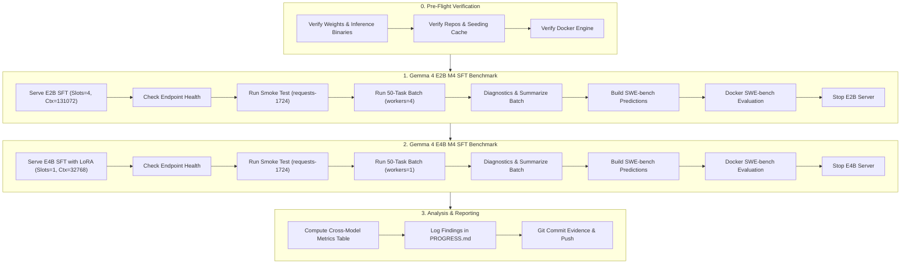

# TASK.md: SWE-Bench Benchmark Guide for Fine-Tuned Gemma 4 Models (E2B & E4B M4 SFT)

## 1. Executive Summary & Research Context

Following the completion of native Supervised Fine-Tuning (SFT) on Kaggle GPU across 3,000 multi-turn trajectories (`data/sft_m4_3000.jsonl`), this guide directs the coding agent to benchmark the fine-tuned models on the **50-task SWE-bench Verified Mini subset** (`data/subset_50.json`).

### Target Models & Configurations
1. **`gemma-4-E2B-M4-sft`** (Merged & Quantized 4-bit Q4_0: `models/gemma-4-E2B-M4-sft_q4_0-it.gguf`, 3.18 GB).
2. **`gemma-4-E4B-M4-sft`** (Base 4-bit Q4_0: `models/gemma-4-E4B_q4_0-it.gguf`, 4.80 GB + LoRA adapter: `models/gemma-4-E4B-M4-sft-lora.gguf`, 133 MB).

### Research Questions / Hypotheses to Validate
- **H1 (Tool Call Reliability):** Does SFT on aligned tool-call syntax eliminate `malformed_arguments`, invalid JSON separators (`{"pattern=\"x\"\npath": ...}`), and loop cycles?
- **H2 (Compaction Timing):** Does SFT accelerate Phase 1 $\rightarrow$ Phase 2 compaction transition to optimal early turns ($t \le 3$), eliminating `SYMBOL_NOT_FOUND` errors?
- **H3 (Resolution Rate Lift):** Does native SFT improve end-to-end SWE-bench resolve rates beyond the base model baselines?
  - Base `gemma-4-E2B_M4` resolved: **4 / 50 (8.0%)**.
  - Base `gemma-4-E4B_M4` resolved: **9 / 50 (18.0%)**.

---

## 2. Hard Operational Rules (Strict Adherence Required)

Per [AGENTS.md](file:///D:/Research/gemma-4-hackathon/AGENTS.md):
1. **Always run Python from `.venv`:** Never call system `python`. Use `.\.venv\Scripts\python.exe`.
2. **Organise every experiment under its own bundle:**
   - E2B SFT: `experiments/20261029-e2b-m4-sft/`
   - E4B SFT: `experiments/20261029-e4b-m4-sft/`
   Never contaminate another experiment's folder or default root.
3. **Never commit weights or checkouts:**
   - Do NOT commit `models/`, `.venv/`, `repos/`, `worktrees/`, or log files (`experiments/**/*.log`).
   - DO commit the run evidence: `runs/*.jsonl`, `patches/*.patch`, `manifest.json`, `results.csv`, `DIAGNOSTICS.md`, `predictions/*.jsonl`, `reports/*.json`, and `swebench_results.csv`.
4. **VRAM & Context Budget (RTX 4050 6GB Laptop):**
   - **E2B SFT:** Supports 4 parallel slots with 32,768 context each (`-Ctx 131072 -Slots 4`). Agent workers = `4`.
   - **E4B SFT:** Must run single slot (`-Ctx 32768 -Slots 1`) to fit within 6GB VRAM (~4.0 GB VRAM consumed with LoRA). Agent workers = `1`.
5. **Always explicitly specify `--thinking on` and `temperature=0.0`** (managed by harness).

---

## 3. End-to-End Benchmark Execution Workflow



---

## 4. Step-by-Step Instructions

### Step 0: Pre-Flight Verification

Execute in PowerShell from project root (`D:\Research\gemma-4-hackathon`):

```powershell
# 1. Verify Python virtual environment
.\.venv\Scripts\python.exe -c "import datasets, openai, tree_sitter; print('Venv OK')"

# 2. Verify model weights exist
Test-Path "models\gemma-4-E2B-M4-sft_q4_0-it.gguf"    # Must be True (~3.18 GB)
Test-Path "models\gemma-4-E4B_q4_0-it.gguf"            # Must be True (~4.80 GB)
Test-Path "models\gemma-4-E4B-M4-sft-lora.gguf"        # Must be True (~133 MB)
Test-Path "tools\llama.cpp\llama-server.exe"           # Must be True

# 3. Verify Docker daemon is running (for Step 5 evaluation)
docker info --format '{{.ServerVersion}}'
```

---

### Step 1: Benchmark Gemma 4 E2B M4 SFT

#### 1.1 Start E2B SFT Inference Server
Launch llama-server with 4 slots (32K context per slot):
```powershell
# Kill any existing server first
Stop-Process -Name llama-server -ErrorAction SilentlyContinue

# Launch E2B SFT server (runs in background)
powershell -NoProfile -ExecutionPolicy Bypass -File scripts\serve.ps1 -Model E2B -Sft -Ctx 131072 -Slots 4
```

#### 1.2 Verify Endpoint
```powershell
# Health & tool-calling probe
.\.venv\Scripts\python.exe scripts\check_endpoint.py
```
*Wait until exit code is 0 before continuing.*

#### 1.3 Smoke Test Single Task
Run a single task to ensure turn-0 seeding, tool dispatch, and diff generation operate correctly:
```powershell
.\.venv\Scripts\python.exe scripts\run_task.py --instance-id psf__requests-1724 --variant M4 `
    --model gemma-4-E2B-M4-sft --thinking on --experiment 20261029-e2b-m4-sft
```

#### 1.4 Run Full 50-Task Batch
Run the 50 tasks across 4 concurrent worker threads:
```powershell
.\.venv\Scripts\python.exe scripts\run_batch.py --model gemma-4-E2B-M4-sft --variants M4 `
    --thinking on --experiment 20261029-e2b-m4-sft --workers 4
```
*Note: `run_batch.py` is fully resumable. If interrupted, simply re-run the same command.*

#### 1.5 Generate Diagnostics & Summary
```powershell
# Aggregated metrics table & results.csv
.\.venv\Scripts\python.exe scripts\summarize_batch.py --experiment 20261029-e2b-m4-sft `
    --csv experiments\20261029-e2b-m4-sft\results.csv

# Detailed diagnostics report (error taxonomy & context depth)
.\.venv\Scripts\python.exe scripts\diagnostics_e2b.py --experiment 20261029-e2b-m4-sft `
    --out experiments\20261029-e2b-m4-sft\DIAGNOSTICS.md
```

#### 1.6 Build Predictions & Run SWE-bench Evaluation
```powershell
# 1. Package predictions into experiments/20261029-e2b-m4-sft/predictions/
.\.venv\Scripts\python.exe scripts\build_predictions.py --experiment 20261029-e2b-m4-sft

# 2. Run Docker evaluation across 4 workers
.\.venv\Scripts\python.exe scripts\run_swebench_eval.py --experiment 20261029-e2b-m4-sft --max-workers 4
```

#### 1.7 Stop E2B Server
```powershell
Stop-Process -Name llama-server -ErrorAction SilentlyContinue
```

---

### Step 2: Benchmark Gemma 4 E4B M4 SFT

#### 2.1 Start E4B SFT Inference Server (with LoRA Adapter)
Launch llama-server with 1 slot (32K context) and the LoRA adapter applied:
```powershell
Stop-Process -Name llama-server -ErrorAction SilentlyContinue

# Launch E4B SFT server with LoRA adapter
powershell -NoProfile -ExecutionPolicy Bypass -File scripts\serve.ps1 -Model E4B -Sft -Ctx 32768 -Slots 1
```

#### 2.2 Verify Endpoint
```powershell
.\.venv\Scripts\python.exe scripts\check_endpoint.py
```

#### 2.3 Smoke Test Single Task
```powershell
.\.venv\Scripts\python.exe scripts\run_task.py --instance-id psf__requests-1724 --variant M4 `
    --model gemma-4-E4B-M4-sft --thinking on --experiment 20261029-e4b-m4-sft
```

#### 2.4 Run Full 50-Task Batch
Run the 50 tasks with 1 worker:
```powershell
.\.venv\Scripts\python.exe scripts\run_batch.py --model gemma-4-E4B-M4-sft --variants M4 `
    --thinking on --experiment 20261029-e4b-m4-sft --workers 1
```

#### 2.5 Generate Diagnostics & Summary
```powershell
.\.venv\Scripts\python.exe scripts\summarize_batch.py --experiment 20261029-e4b-m4-sft `
    --csv experiments\20261029-e4b-m4-sft\results.csv

.\.venv\Scripts\python.exe scripts\diagnostics_e2b.py --experiment 20261029-e4b-m4-sft `
    --out experiments\20261029-e4b-m4-sft\DIAGNOSTICS.md
```

#### 2.6 Build Predictions & Run SWE-bench Evaluation
```powershell
# 1. Package predictions into experiments/20261029-e4b-m4-sft/predictions/
.\.venv\Scripts\python.exe scripts\build_predictions.py --experiment 20261029-e4b-m4-sft

# 2. Run Docker evaluation across 4 workers
.\.venv\Scripts\python.exe scripts\run_swebench_eval.py --experiment 20261029-e4b-m4-sft --max-workers 4
```

#### 2.7 Stop E4B Server
```powershell
Stop-Process -Name llama-server -ErrorAction SilentlyContinue
```

---

### Step 3: Comparative Analysis & Reporting

#### 3.1 Extract Benchmark Results
Collate and present the results in comparison with the base models:

| Metric | Gemma 4 E2B Base M4 | Gemma 4 E2B SFT M4 | Gemma 4 E4B Base M4 | Gemma 4 E4B SFT M4 |
|---|---|---|---|---|
| **Resolved / 50 (%)** | 4 / 50 (8.0%) | **? / 50 (?%)** | 9 / 50 (18.0%) | **? / 50 (?%)** |
| **Real Edits Generated (%)** | 46 / 50 (92.0%) | ? | 49 / 50 (98.0%) | ? |
| **Malformed Arguments** | 6 | ? | 1 | ? |
| **Malformed Edits** | 12 | ? | 5 | ? |
| **Compaction Trigger Rate (%)** | 48 / 50 (96.0%) | ? | 39 / 50 (78.0%) | ? |
| **Median Turns to Compaction** | 3.0 | ? | 3.0 | ? |
| **Mean Total Tokens** | 16,840 | ? | 20,410 | ? |
| **Loop Blocked Count** | 4 | ? | 0 | ? |

#### 3.2 Update Project Documentation
1. Append entry to [PROGRESS.md](file:///D:/Research/gemma-4-hackathon/PROGRESS.md) with exact date, resolved counts, resolved instance IDs, and key diagnostic findings.
2. Verify git status to ensure only tracked evidence files are staged:
   ```powershell
   git status
   # Check that models/, logs/, worktrees/, and run_evaluation/ are NOT staged
   git add experiments/20261029-e2b-m4-sft experiments/20261029-e4b-m4-sft PROGRESS.md TASK.md
   git commit -m "feat(eval): benchmark fine-tuned gemma-4-E2B and E4B M4 models on swe-bench"
   git push origin main
   ```

---

## 5. Troubleshooting & Agent Runbook

| Symptom | Root Cause | Remediation |
|---|---|---|
| `Context size has been exceeded (500)` | Server launched with shared KV context (`-c`) smaller than `32768 * slots`. | Ensure E2B uses `-Ctx 131072 -Slots 4`. Verify with `.\.venv\Scripts\python.exe scripts\check_endpoint.py`. |
| `HTTP 524 / Read Timeout` | Turn buffered through Cloudflare proxy. | The harness defaults to `stream: true`. If using remote Colab, ensure streaming is not disabled. |
| `No space left on device` during Docker eval | Docker prune needed for stale containers/images. | Run `docker system prune -f --volumes` to recover space. |
| `KeyError: 'image'` during SWE-bench | Outdated SWE-bench dataset name. | Dataset must be `SWE-bench/SWE-bench_Verified` (handled automatically by `scripts/run_swebench_eval.py`). |
| Incomplete batch after interruption | Interrupted process or timeout. | Re-run `scripts/run_batch.py` with the exact same arguments; it skips already completed cells automatically. |
| Inspecting an individual failure | Debugging a malformed edit or agent rambling. | Run `.\.venv\Scripts\python.exe scripts\summarize_run.py <path_to_jsonl> --show-tool apply_edit`. |
